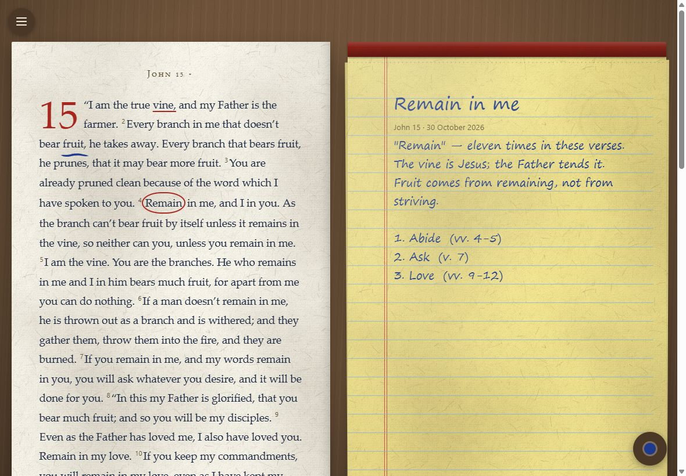

# Sermon Workshop — workshop.yhwh.rest

Soli Deo gloria. Made for Darrell W. Johnson.

A quiet desk for working on a passage: the Bible open on one side, a yellow legal
pad on the other, and nothing else on screen. Begin a study the way a Bible is
opened (its contents, then a chapter), mark words on the page (tap: underline,
circle, box), and write on the pad by hand with an Apple Pencil or with the
keyboard. Print your notes, or print the passage beside ruled lines on legal
paper. Everything else is in one corner menu. Companion to
[Gospel Parallels](https://gospels.yhwh.rest).



Both pages keep one width (548px) whether an iPad is upright or sideways, as
paper does, so ink written in one orientation stays on its words in the other.

## Develop

```sh
npm install
tilt up          # then open http://localhost:10350
```

The `Tiltfile` runs the whole loop on this machine, with no cluster: the dev server
(http://localhost:5180, instant reload), typecheck, lint, unit tests, the production
build served as static files the way GitHub Pages serves it (http://localhost:4180),
and the browser tests against that build. Each re-runs when its files change.

Measured on the development machine: a change shows in the dev server in ~0.2s;
typecheck 10s, lint 8s, unit tests 8s, build 7s; the browser tests ~110s.

Without Tilt:

```sh
npm run dev      # dev server
npm test         # unit tests (Vitest)
npm run e2e      # browser tests (Playwright; builds and serves the site itself)
npm run build    # static site in dist/
```

The browser tests (`e2e/`) run in WebKit, the engine iPad Safari uses, at iPad
sizes upright and sideways and at phone size, and in Chromium on a desktop. Every
test fails if the page logs a console error. Install the browsers once with
`npx playwright install webkit chromium`.

Changes go through pull requests; CI runs the unit and browser tests on each, and
merging into `main` publishes.

## Where studies live

In the browser that made them (localStorage), with "Save a copy" and "Open a saved
copy" as a file. Studies were first called "pads": the storage key and the old file
format are still read, so nothing saved under the old name is lost.
There is no server. If the saved data is ever unreadable, the workshop says so and
offers to download it; it never starts empty over it, since the next save would
overwrite it. Records carry ids and timestamps so syncing can be added later.

## Paper styles

A paper style (a "skin" in the code) is a JSON description of the paper, inks, desk and fonts (from a fixed set),
in the `workshop-skin/1` format documented in `src/lib/skin.ts`. Skins are data,
never CSS or script, because they come from strangers and pads hold private notes:
`validateSkin` refuses web addresses, anything that is not a plain color or number,
and text that would be hard to read (WCAG contrast). The Paper page gives a prompt
to paste into any AI, and accepts what it writes back.

The paper itself (fibres, mottling, the lit tooth of the surface, the binding and
the sheets beneath) is drawn by `src/lib/paper.ts` and the stylesheet from a skin's
numbers; skins tune it but cannot change how it is drawn.

## Text

World English Bible (public domain), all 66 books, from eBible.org:

```sh
curl -L -o engwebp_vpl.zip https://eBible.org/Scriptures/engwebp_vpl.zip
unzip engwebp_vpl.zip -d engwebp
npm run text -- engwebp/engwebp_vpl.txt
```

The build checks every book's chapter count and the total of 31,103 verses.

### References (Compare)

Other translations and commentaries are **not** copied in. They are fetched a chapter
at a time from the [Free Use Bible API](https://bible.helloao.org/) (`src/lib/reference.ts`
is the only file that knows about it). All are public domain except the Tyndale Open
Study Notes (CC BY-SA 4.0), whose credit is shown under the notes and on About.

- The API's book ids are USFM (`JHN`), ours are eBible's (`JOH`); eleven differ, and a
  wrong one would come back 404 and read as "nothing on this chapter". The unit test
  checks all 66 against the API's own list.
- A 404 means the source has nothing on that chapter and says so quietly; a failed or
  unreadable answer is an alert with Try again. The two are never shown alike.
- The browser e2e tests serve responses recorded from the API (`e2e/recorded/`) so they
  don't depend on its uptime. Re-record one with
  `curl -o e2e/recorded/BSB_JHN_15.json https://bible.helloao.org/api/BSB/JHN/15.json`.
- Opening a reference tells that site which chapter is being read. Nothing written is sent.

### Cross-references (tap a verse number)

OpenBible.info's reader-voted cross-references (CC BY), built into `public/xref/` (one
file per book, the 12 strongest per verse, 3.2 MB in all):

```sh
curl -L -o cross-references.zip https://a.openbible.info/data/cross-references.zip
unzip cross-references.zip
npm run xref -- cross_references.txt
```

The build stops on an unknown book id and drops references to verses the WEB doesn't
have (128 of 344,799 on 2026-10-31). A unit test reads every reference in all 66 books.
They are related passages, not a list of quotations, and the page says so.

## Hosting

Changes arrive as pull requests; `.github/workflows/ci.yml` runs the tests, lint and
build on each. Merging into `main` publishes through `.github/workflows/deploy.yml`
to GitHub Pages. DNS for
yhwh.rest is on Cloudflare: `workshop` is a `CNAME` to `yhwyorg.github.io` and must
stay **DNS only** (grey cloud), or GitHub cannot issue its HTTPS certificate.
